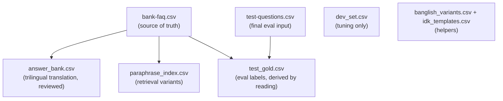

## Data Assets

### Overview

NB Assist uses eight CSV files. Two are provided by the bank (source of truth and final evaluation input). Six are generated by the author as build artifacts — all derived from the FAQ only, with no new facts introduced.

---

### Provided Files

| File | Rows | Columns | Role |
|------|------|---------|------|
| `bank-faq.csv` | 30 | id, topic, question, answer | **Source of truth.** 30 FAQ entries across 30 topics. |
| `test-questions.csv` | 40 | id, question | **Final evaluation input.** 40 questions in mixed English, Bangla script, Banglish. |

---

### Generated Files

| File | Rows | Source | Generated by | Role |
|------|------|--------|--------------|------|
| `answer_bank.csv` | 30 | `bank-faq.csv` | gemma3:4b draft + native-speaker review | Trilingual pre-translation (EN/BN/Banglish). Numbers never touched. `review_status` field reflects review. |
| `paraphrase_index.csv` | 180 | `bank-faq.csv` | Hand-written from FAQ alone | 6 paraphrases per FAQ entry (2 EN + 2 BN + 2 Banglish). Used as retrieval index variants. |
| `dev_set.csv` | 40 | Hand-written | Author | Tuning set. **NOT used in final score.** |
| `test_gold.csv` | 40 | `test-questions.csv` | Derived by reading against FAQ | Labels for final eval only. **Never used for tuning.** |
| `idk_templates.csv` | 3 | Hand-written | Author | "I don't know, let me connect you to a person" in 3 languages. |
| `banglish_variants.csv` | 36 | Hand-written | Author | Spelling variants (kivabe/kibhabe/kemne) for normalizer. Starter list, untested in eval yet. |

---

### Authoring notes and caveats
- **Answer bank:** Pre-translation of `bank-faq.csv` by gemma3:4b, then reviewed line-by-line by the author (a native Bangla speaker). Numbers, currency, dates, and product names were never modified. The `review_status` column tracks this provenance.
- **Paraphrase index:** Drafted from the FAQ alone, not from the test questions. The test questions were seen earlier during the build — paraphrases were screened by a similarity script (max cosine 0.76, all cross-topic). Disclosed in `NOTE.md`.
- **Dev set:** Self-written by the author. NOT used in the final score — only for threshold calibration and prompt iteration.
- **Test gold:** Labels derived by reading the 40 test questions against the FAQ. Used only for the final evaluation run. Never used for tuning.
- **Banglish variants:** A starter list, not yet validated in eval. Documented as a known limitation in `NOTE.md`.
- **IDK templates:** Hand-written, fixed strings. The handoff path involves no generation risk.

---

### Data Flow

---

### Provenance

No new facts introduced. All generated data is a processed form of `bank-faq.csv`.