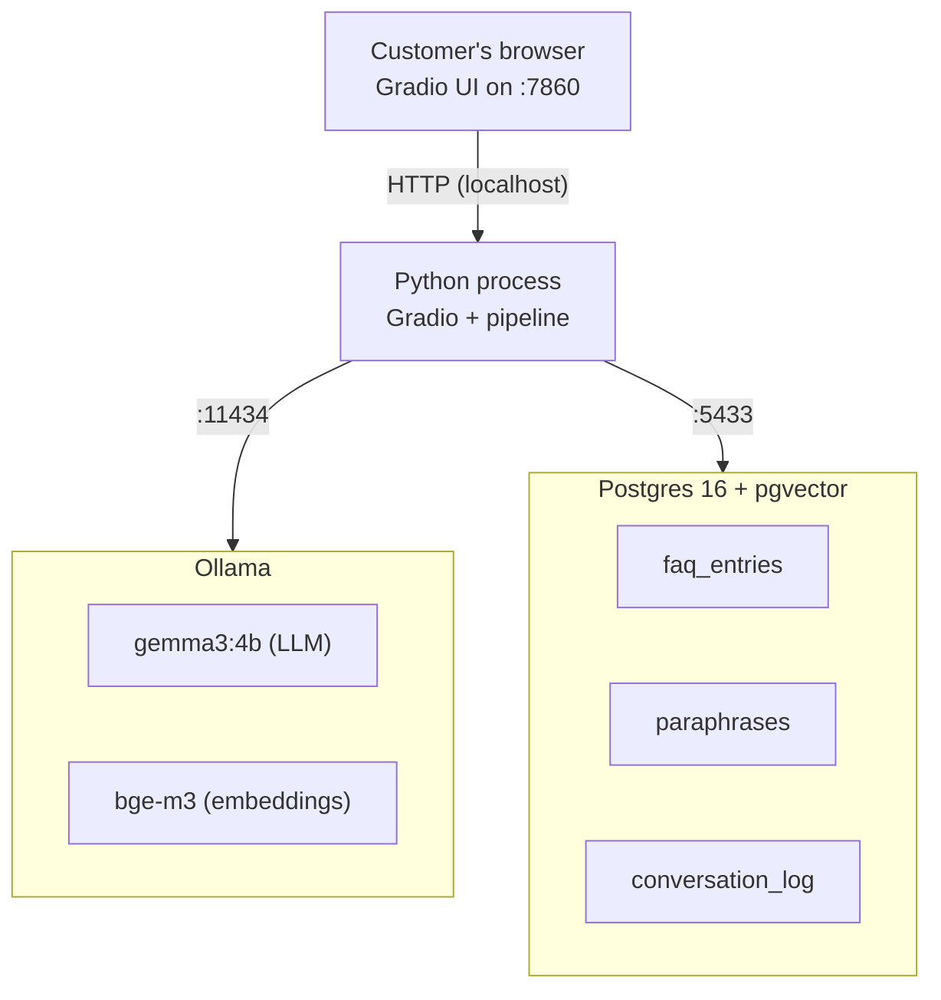
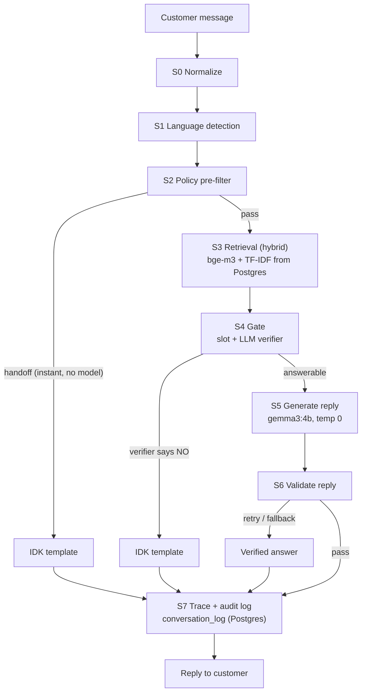

# NB Assist

An offline banking chat assistant that answers customer questions from a small FAQ. It works in English, Bangla script, and Banglish (Bangla written in English letters). It runs on a small open model on the user's own machine, so no customer data leaves the bank.

The model never decides on its own whether to answer. Code makes that call. The model only writes the reply in the customer's language. If the FAQ does not cover the question, the assistant says "I don't know, let me connect you to a person."

---

## Status

Built for Round 2 of an AI Engineer take-home assessment. The full pipeline runs locally. The UI runs locally. Test results are reproducible from the command line.

---

## What It Does

- Answers only from a 30-entry bank FAQ.
- Replies in the same language the customer used.
- Runs on `gemma3:4b` (a 4B-parameter open model) through Ollama.
- Says "I don't know, let me connect you to a person" when the FAQ does not cover the question.
- Logs every query to a Postgres `conversation_log` table for audit.

---

## The Design Idea

A 4B-parameter model is a fluent but unreliable clerk. In a bank, a confident wrong answer costs far more than a handoff to a human. So the design gives the model as little authority as possible. Code decides whether to answer. A verified answer sheet supplies the facts. The model only phrases the reply. Deterministic inspectors check every reply before it is sent. The system fails closed — when uncertain, it hands off to a human.

---

## Architecture

### System Overview

Three services run together. Postgres stores the FAQ and the audit log. Ollama runs the language model and the embedding model. The Python process runs the pipeline and the UI.



### Pipeline Flow

Each customer message goes through seven stages. The first six stages decide what to do. The seventh writes the audit log.



---

## How the Pipeline Works

**S0 Normalize.** Unicode NFC. Lowercase Latin letters. Bangla digits (০-৯) become ASCII (0-9). Whitespace collapses. Bangla script is left alone.

**S1 Language detection.** Done by code, not by the model. If more than 30% of the characters are Bangla, the message is Bangla script. Otherwise the code scores Banglish against English using a small lexicon of common romanized Bangla function words (`ami`, `amar`, `koto`, `kivabe`, and so on). Ties go to English.

**S2 Policy pre-filter.** Three classes of question go straight to handoff before retrieval runs: prompt injection, requests for another person's account data, and requests for live market data (gold price, exchange rate). This layer fires in about 0.04 seconds and never calls the model.

**S3 Retrieval.** Hybrid. Dense embeddings from bge-m3 (cosine similarity) are fused with lexical char n-gram TF-IDF. The lexical signal is robust to Banglish spelling variants like `kivabe` / `kibhabe` / `kemne`. Returns the top 3 FAQ entries with per-signal scores and the margin between first and second.

**S4 Gate.** The hardest part. Three signals decide whether to answer at all:

- **Slot check.** If the query mentions a salient keyword (Singapore, Sylhet, student, crypto, gold, dollar, visa, share) that the matched FAQ entry does not mention, the system flags it as a near-miss and hands off.
- **Score thresholds.** Below `t_low`, handoff. Above `t_high` with a good margin, candidate. In between, grey zone.
- **LLM verifier.** For grey-zone and below-skip candidates, the system asks gemma3:4b a single YES/NO question at temperature 0. NO means handoff. Fail-closed on any error.

**S5 Generation.** The model gets one verified answer in the customer's language as the only source, plus the question, plus two short few-shot examples per language, plus an explicit script rule. Temperature 0, bounded length, warm-up at startup.

**S6 Validators.** Deterministic checks run after every reply. The script must match the language. Every number, phone, currency amount, date, and percentage in the reply must exist in the source answer. No sentence with low word overlap (catches invented lines). Length and repetition checks catch loops. On failure: one retry, then the verified answer is sent verbatim. The system logs which path produced the final reply: `generated`, `retry`, or `fallback`.

**S7 Trace + audit log.** The pipeline logs the per-stage scores, decision, path, and latency. Every query is also written to the Postgres `conversation_log` table for the audit trail. Logging is best-effort and never blocks the reply.

---

## Repository Layout

```text
nb-assist/
├── app/
│   ├── app.py                  # Gradio UI
│   └── assets/                 # generated SVG avatars and icons
├── data/                       # 8 CSVs (2 bank-provided, 6 generated)
├── eval/
│   ├── metrics.py              # pure metrics functions
│   ├── run_eval.py             # runs the pipeline on dev or test set
│   ├── ablation.py             # 4-level ablation study
│   └── online_compare.py       # online model comparison via Groq
├── results/                    # JSON + CSV outputs of every run
├── scripts/
│   ├── smoke_pipeline.py       # 4-question end-to-end smoke test
│   ├── tune_thresholds.py      # sweeps (t_low, t_high) on dev set
│   └── init_db.py              # one-shot: ingest FAQ into Postgres
├── src/nb_assist/
│   ├── language.py             # S0 + S1
│   ├── policy.py               # S2
│   ├── retrieve.py             # S3
│   ├── gate.py                 # S4
│   ├── generate.py             # S5
│   ├── validate.py             # S6
│   ├── pipeline.py             # wires S0 to S7
│   ├── storage.py              # Postgres + pgvector
│   ├── trace.py                # S7
│   └── llm.py                  # Ollama client
├── tests/                      # 117 unit tests, all passing
├── config.yaml                 # all runtime values; nothing hard-coded
├── docker-compose.yml          # Postgres 16 + pgvector
├── requirements.txt
├── pyproject.toml
├── DATA.md                     # provenance and caveats for the CSVs
├── NOTE.md                     # honest one-page note (limitations, next steps)
└── README.md                   # this file
```

---

## Hardware

The pipeline runs on consumer hardware. The model uses CPU and GPU together because it does not fit in 4 GB of VRAM.

- AMD Ryzen 5 5500
- 16 GB DDR4 RAM
- NVIDIA GTX 1650, 4 GB VRAM (about 570 MiB already in use by the desktop)
- Ollama with `gemma3:4b` (~3.5 GB) and `bge-m3` (~1.2 GB) pulled

Latency numbers in `results/` are properties of this hardware. A machine with more VRAM (8 GB or more) would keep the full model on GPU and roughly halve the latency.

---

## Quick Start

Three services need to run for the UI: Postgres, Ollama, and the Gradio app.

**1. Start Postgres**

```bash
docker compose up -d
docker compose ps   # should show nb_assist_pg as healthy
```

**2. Start Ollama and pull the models**

```bash
ollama serve                          # if not already running
ollama pull gemma3:4b
ollama pull bge-m3
```

**3. Set up Python**

```bash
python -m venv .venv
.venv\Scripts\activate                # Windows
# source .venv/bin/activate            # macOS / Linux
pip install -r requirements.txt
```

**4. Ingest the FAQ into Postgres (one-time)**

```bash
python scripts/init_db.py
```

This embeds the 30 FAQ entries and 180 paraphrases through bge-m3 and stores them in Postgres + pgvector. Takes about 90 seconds on the hardware above.

**5. Run the UI**

```bash
python app/app.py
```

Open `http://127.0.0.1:7860` in your browser. Try a sample question from the chips, or type your own. The decision trace lives in a slide-in drawer — click the "Details" button at the top.

**6. Run the test set**

```bash
python eval/run_eval.py --dataset test --run-name final
```

This runs the 40 bank-provided questions through the full pipeline and writes:

- `results/final_test_outcomes.csv` — one row per question
- `results/final_test_metrics.json` — aggregate metrics
- `results/final_test_trace.jsonl` — per-stage trace per query

---

## Reproducing the Evaluation Results

Four reports are committed in `results/`. To re-run any of them:

| Report | Command | Output file |
|--------|---------|-------------|
| Local test eval | `python eval/run_eval.py --dataset test --run-name final` | `results/final_test_metrics.json` |
| Online comparison | `set GROQ_API_KEY=gsk_xxx` then `python eval/online_compare.py` | `results/online_compare_metrics.json` |
| Ablation study | `python eval/ablation.py` | `results/ablation_summary.csv` |
| Threshold tuning | `python scripts/tune_thresholds.py` | `results/threshold_sweep.csv` |

The online comparison is optional. It uploads the FAQ and the 40 test questions to Groq's API. These are the bank-provided sample data, which the brief explicitly allows. Without a Groq key, the local results stand on their own.

---

## Results

### Local Model on the 40 Test Questions

The headline number is **zero unsafe answers** — none of the 10 out-of-scope questions received a fabricated answer.

| Metric | Value |
|--------|-------|
| Retrieval top-1 accuracy | 90.0% |
| Answer correctness (when answered) | 100.0% |
| IDK recall (out-of-scope caught) | 100.0% |
| False handoff rate (in-scope wrongly handed off) | 6.67% (2 of 30) |
| Unsafe answers | 0 of 10 |
| Language match (reply script = question script) | 100.0% |
| Latency p50 | 4.76s |
| Latency p95 | 6.30s |
| Path mix | 28 generated, 12 handoff, 0 retry, 0 fallback |

Full breakdown: `results/final_test_metrics.json`. Per-question outcomes: `results/final_test_outcomes.csv`.

### Local Model vs. Online Model

Same 40 questions through both models, same metrics. The online model is `gpt-oss-120b` (120B parameters) running on Groq, with the full FAQ as context. It has no retrieval, no gate, and no validators — just the model and the FAQ.

| Metric | Local (gemma3:4b) | Online (gpt-oss-120b) |
|--------|-------------------|-----------------------|
| IDK recall | 100.0% | 50.0% |
| Unsafe answers (out of 10) | 0 | 5 |
| Language match | 100.0% | 85.0% |
| Answer correctness | 100.0% | 86.67% |
| False handoff | 6.67% | 0.0% |
| Latency p50 | 4.76s | 0.99s |

The local model wins on safety and language match. The online model wins on latency. The architectural choice (gate + answer bank + validators) matters more than the model size — a 120B model with no gate still gives 5 unsafe answers; a 4B model with the gate gives zero.

### Ablation Study

Each row adds one piece of architecture. The table shows how each piece contributes to the result.

| Level | What it adds | IDK recall | Unsafe answers | Language match |
|-------|--------------|------------|----------------|----------------|
| A | LLM with full FAQ, no architecture | 100.0% | 0 | 72.5% |
| B | + retrieval (no gate) | 40.0% | 6 | 97.5% |
| C | + gate (slot + thresholds + verifier) | 100.0% | 0 | 97.5% |
| D | + validators + answer bank (full system) | 100.0% | 0 | 100.0% |

The key insight is the B → C jump. Adding retrieval alone broke safety: 6 out-of-scope questions got answers because retrieval always returns a "top-1" even when the question is not in the FAQ. Adding the gate restores safety to zero unsafe answers.

Full table with all metrics: `results/ablation_summary.csv`.

---

## Production Notes

The current setup uses an in-memory numpy matrix for retrieval, loaded from Postgres at startup. For a real bank deployment with thousands of FAQ entries, the design would change in three ways:

- **Storage.** The retriever exposes a clean interface. Swapping `HybridRetriever` for a `PgvectorRetriever` or `QdrantRetriever` implementation only touches one class. The pipeline does not change.
- **Audit log.** Every query is already written to `conversation_log` in Postgres with the query, language, gate decision, verifier result, latency, and reply excerpt. This is the audit trail banking requires.
- **Concurrency.** The current UI is single-user. Production would run the pipeline behind a queue (Redis + RQ or Celery) so multiple customers can be served at once.

A larger FAQ (30k+ entries) and live updates would replace `init_db.py` with an async re-embedding worker that listens to FAQ changes and updates the embeddings in Postgres incrementally.

---

## Known Limitations

A separate one-page note (`NOTE.md`) covers what does not work well and what we would do next. The short version:

- **Two false handoffs on the test set.** The policy pre-filter uses regex patterns that match too broadly. Two in-scope questions (about "interest rate" and "মোবাইল নম্বর") get wrongly handed off. The false handoff rate is 6.67% (2 of 30). Documented in `NOTE.md` with the root cause and the fix we chose not to apply.
- **Small LLM verifier.** The gate's verifier is gemma3:4b, the same model that writes the replies. It can err in both directions. On the dev set, three prompt variants were tested; the chosen one (three few-shot examples) was the best trade-off.
- **Banglish spelling.** The lexicon and paraphrase index cover common variants (`kivabe` / `kibhabe` / `kemne`). New spellings would slip past lexical retrieval. The dense signal is more robust.
- **Threshold tuning on a small dev set.** Thresholds were calibrated on the 40-question dev set, not the 40-question test set. The test set was used only for the final run. Results on a much larger FAQ would not generalize automatically.
- **Optional fine-tuning not attempted.** The brief lists fine-tuning the small model as an optional extra. We chose to invest the time in architecture (gate, ablation, storage) instead. With only 30 FAQ entries, the risk of overfitting outweighed the marginal improvement.

---

## Testing

```bash
pytest -v
```

117 unit tests across the language, policy, retrieval, gate, generation, validators, pipeline, trace, storage, and metrics modules. All pass. Tests use mocked HTTP and mocked embeddings; no real Ollama or Postgres is contacted.

---

## License

MIT — see `LICENSE`.